<!-- the ink in note.svg is drawn with EngiNote's pens -->

  

 

### things i've made

**[EngiNote](https://github.com/ayushheheheha/EngiNote)** · [try it](https://enginote.vercel.app) 
Write on HTML notes the way you'd write on a PDF. A website, and an iPad app with Apple Pencil support and a screen recorder. The ink in the picture above is drawn by its pens.

**[ScenePack Maker](https://github.com/ayushheheheha/scenepack_maker)** 
A desktop app for cutting scenes out of drama episodes and sorting them into scene packs. Electron and React, no database: every project is one file on disk.

**[HackDesk v2](https://github.com/ayushheheheha/hackdesk_v2)** 
Hackathon management for VIT Vellore in plain PHP and MySQL, with QR codes, mail and PDFs.

**[GenzLAB](https://github.com/ayushheheheha/sqlab)** 
A SQL lab, coding challenges and quizzes for students in one place, with hints and leaderboards.

**[Computational Thinking](https://computational-thinking-five.vercel.app)** 
Study notes you can poke at: an interactive take on the first week of the course.

 

  
    
  M.Tech Software Engineering · VIT Vellore · batch of 2028 · <a href="https://www.linkedin.com/in/ayushsksksk/">LinkedIn</a>
   
  <a href="https://github.com/ayushheheheha/hello-ayush">if you are reading this it's too late.</a>

